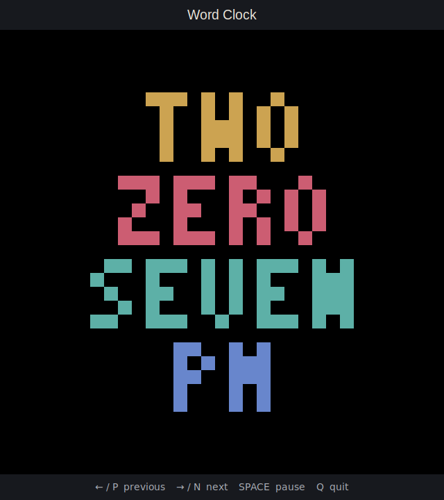

# SiriusVision

Pixel-art screens for Sirius, a boat with a planned 64×64 LED display. Phase 1
runs entirely offline on a Mac; no Pi, network, Spotify account or credentials
are needed.



## macOS quick start

Install Python 3.11 or newer from [python.org](https://www.python.org/downloads/macos/)
with Tk support. Check `python3 -m tkinter` opens a window. Some Homebrew
Python installations require the matching `python-tk` package. Then:

```sh
python3 -m venv .venv
source .venv/bin/activate
python -m pip install -e '.[dev]'
python -m siriusvision --display preview
```

After installation, the last command is the one-command startup. The
640×640 preview scales the 64×64 RGB frame with nearest-neighbour pixels.
The title, optional grid overlay and controls are simulator UI, not part of
the native frame.

- **N / right**: next screen; **P / left**: previous screen.
- **Space**: pause/resume rotation; **1–4**: select a screen in configured
  order; **Q**: quit. Screen changes cross-fade in the preview.
- The default rotation is 30 seconds; pausing does not stop clock updates or
  the tide animation.

```sh
python -m siriusvision --display preview --screen word-clock --time 14:07
python -m siriusvision --display preview --screen tide-moon --demo
python -m siriusvision --display png --screen letter-clock --time 12:22 --output /tmp/clock.png
python -m pytest
```

`--time HH:MM` overrides the current local time on today's date (24-hour
input). Without it, the clock uses the configured timezone, including DST.
PNG output is a single 64×64 RGB frame and works without Tk. The preview
requires a graphical desktop and Tkinter.

## Configuration and screens

Copy `config.example.json` to an appropriate local path and pass
`--config /path/to/config.json`; otherwise built-in defaults are used. Set
screen order, `cycle_seconds` (1–86400), logical `brightness` (0–100),
IANA `timezone`, `clock_format` (12 or 24), `show_grid`, and at least four
hexadecimal `palette` colours. Brightness is applied at output, not inside
screen rendering. Invalid settings are reported on startup.

* **Word clock:** complete words at native resolution, dynamically scaled to
  fit. Minutes below ten include ZERO. In 12-hour mode AM/PM is shown for
  minutes 00–19; for 20–59 it is omitted to keep the face uncluttered.
  24-hour mode spells the hour from ZERO to TWENTY THREE.
* **Letter clock:** an original ten-row, fifteen-column face of 3×5 glyphs
  on a 4×6 pitch, starting at (2,2). Dim letters stay in place; highlighted
  spans spell the time rounded to the nearest five minutes. Separate FIVE
  and TEN spans distinguish minutes from hours; the hour advances for
  “TO” and at the rounding boundary near the hour.
* **Tide + moon:** the wave is **DEMO DATA**, not a Thames prediction or
  navigational information. `demo_tides` defaults to true and the screen
  labels it visibly; `--demo` enables it explicitly. Set `demo_tides` to
  false to show OFFLINE until a real provider exists. The moon is an offline
  approximation using a 29.530588853-day synodic period from the
  2000-01-06 18:14 UTC new-moon epoch; it is not an ephemeris.
* **Album art:** a generated, original sunset gradient, not Spotify artwork.

## Architecture and phase status

Each screen implements `render(context)` and returns a native Pillow RGB
image; it has no knowledge of the output backend. The context carries
timezone-aware time, palette, brightness and optional tide data. The screen
manager supplies offline data before drawing and offers selection and
cycling APIs. The preview and PNG displays validate frames and apply output
brightness. The tiny bitmap font is original to this project.

Only Phase 1 is implemented. No real tide provider, Spotify OAuth, personal
photos, matrix backend, web UI or GPIO button is included. Real providers
must later run independently of rendering, handle failures and timeouts, and
label their sources. `.env`, tokens, caches and private `photos/` are ignored;
never commit credentials or personal images.

## Later Pi hardware stage — not yet implemented

The target is an original Raspberry Pi Model B with its 26-pin header and
Ethernet, and one 64×64 P3 HUB75 panel with 1/32 scan and ABCDE addressing.
Use a **separately installed**, not vendored, [rpi-rgb-led-matrix
library](https://github.com/hzeller/rpi-rgb-led-matrix). Before connecting,
check the actual panel and the library's [wiring
documentation](https://github.com/hzeller/rpi-rgb-led-matrix/blob/master/wiring.md);
`regular-pi1` is a starting point, not verified wiring. A 64-row panel needs
the E address connection. Signal buffering from 3.3V to 5V may be needed.

With power disconnected, verify polarity, connections and a common logic
ground. Power the matrix from its **own regulated 5V supply**, never from Pi
GPIO; power the Pi separately via micro-USB. Check everything before powering
the supplies, and power down before changing wiring. Verify the library's
64×64 demo before attempting application integration. Refresh/flicker and
CPU limits on the Pi 1 may require slower or disabled animation.

Python 3.11+ and Pillow 13 are the development targets; neither installation
nor ARMv6 wheels have been verified on a Pi 1. A compatible Pi OS and Python,
and possibly a source build of Pillow and the native matrix library, must be
verified on the device. No blanket sudo is needed on Mac. If the eventual
matrix driver requires elevated privileges, use only the permissions or
dedicated service required by that driver; do not run development tools as
root. Check remaining pins before considering any physical button.
